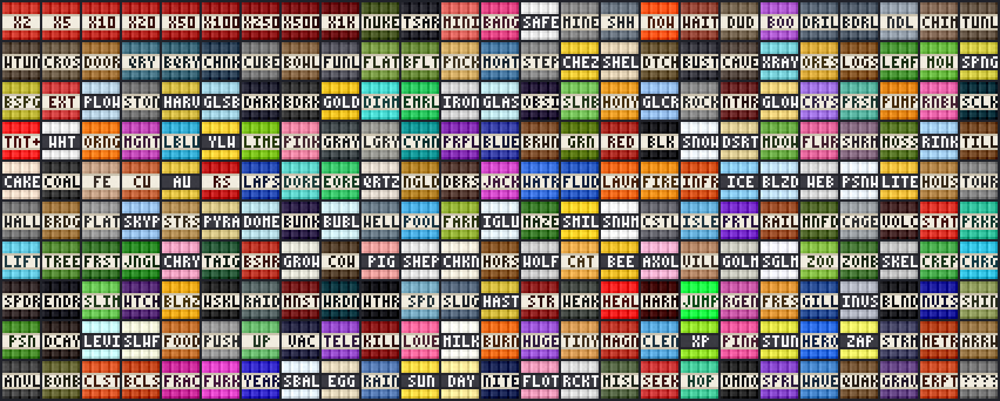

# TNT Mania

A Minecraft mod (Fabric, Minecraft 26.2) that adds **250 new kinds of TNT**, plus a fill mode that places a whole area of TNT with one click.



Every TNT is a real block with its own look, a crafting recipe, and a line under its name that tells you what it does. You light them like normal TNT: flint and steel, redstone, fire, a dispenser or another blast.

## What is in it

| Group | How many | Examples |
|---|---|---|
| Bigger blasts | 11 | TNT x2 up to x1000, Nuke, Tsar (a crater 120 blocks wide) |
| Small and odd | 9 | Mining TNT that drops every block, silent, instant, dud |
| Digging shapes | 24 | drill, tunnel, quarry, a whole chunk, staircase, cave room |
| Picky TNT | 14 | X-Ray (leaves the ores), Ore Miner, Lumberjack, Sponge |
| Turn-into TNT | 18 | gold, diamond, glass, slime, rainbow wool |
| Paint TNT | 16 | one per colour |
| Ground changers | 9 | snow, desert, flowers, cake |
| Ore makers | 12 | coal up to ancient debris |
| Liquids, fire and ice | 10 | flood, lava, inferno, blizzard, a torch TNT that lights a cave |
| Builders | 28 | house, castle, bridge, hedge maze, Nether portal, bubble elevator |
| Plants | 7 | a tree, a forest, giant mushrooms |
| Mob TNT | 27 | cows, a zoo, charged creepers, a Warden |
| Potion TNT | 20 | speed, healing, levitation, feast |
| Mob tricks | 16 | knockback, teleport, big, tiny, magnet |
| From the sky | 17 | lightning, meteors, carpet bomb, fireworks |
| Moving TNT | 12 | rocket, missile, homing, jumping, random |

The full list with pictures and recipes is in [`ALL-250-TNT.html`](ALL-250-TNT.html) (download it and open it in a browser).

## Fill mode

Press Esc and click **TNT Mania**. Switch fill mode on and set how wide, how long and how high (up to 50 x 50 x 10). Now placing one TNT places that whole area of it. It fills empty space only and goes forward from the block you place. In survival it uses the TNT from your inventory.

## Installing

1. Install [Fabric](https://fabricmc.net/) for Minecraft 26.2 and the [Fabric API](https://github.com/FabricMC/fabric) mod.
2. Download the `tntmania` jar from the **Releases** page of this repository.
3. Put it in your `mods` folder.

Everyone who plays needs the mod, and so does the server.

## Good to know

- Obsidian survives the big blasts. Only the Bedrock Breaker TNT breaks bedrock.
- The biggest craters are dug a bit at a time, so the game keeps running. Lighting thousands of TNT at once will still lag.
- Some of the TNT is very strong in survival. It is meant for fun, not for balance.
- Blocks from this mod disappear from a world if you remove the mod.

## Made with AI

The idea for the mod and for fill mode are mine, and I test it in my own game. The list of TNT, the code and the block pictures were made with an AI assistant (Claude).

## For people who want to look at the code

All 250 TNTs come from one table: [`src/shared/resources/tntmania/tnt-types.txt`](src/shared/resources/tntmania/tnt-types.txt). One line is one TNT. The build draws the block pictures and writes the recipes from that table.

Building needs JDK 25:

```
gradle build
```

The automatic tests run inside a real game server with no window:

```
gradle runGametest
```

## License

MIT. See [LICENSE](LICENSE).
